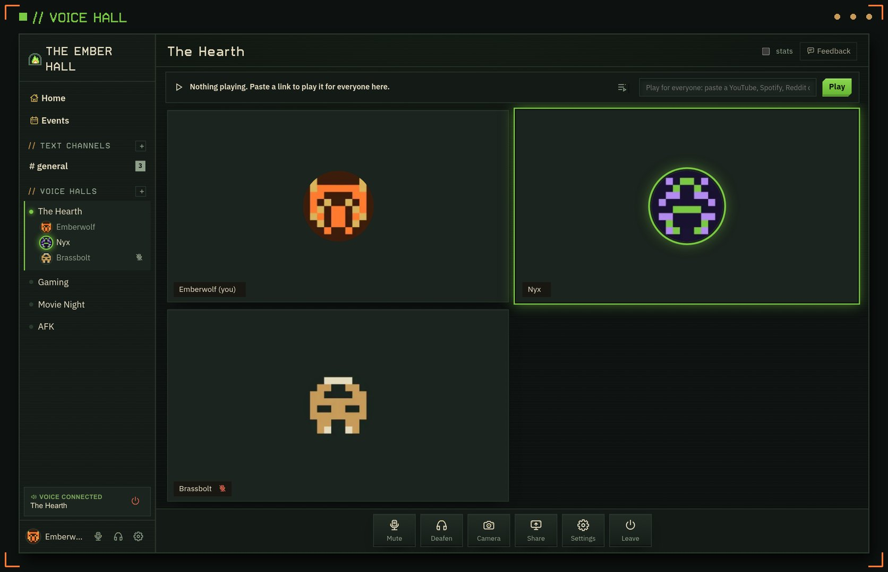

  

<b>Downloads.</b> Your own private hangout, like the big chat apps, but hosted by your crew. 
No ads, no data mining, signed updates.

## // The easy way: your hall's website

Your host sends you the hall's address (for example
`https://hearthone.duckdns.org:4443`). Open it in a browser, sign in, and it
offers **the right installer for your computer**. It's the same file as
below, but that page also links the app to your account with a short code.

## // Or grab it here

Open **[the latest release](../../releases/latest)** and pick your system:

| Your computer | Download the file ending in | First launch |
|---|---|---|
| **Windows** | `.exe` (one click: removes old copies, keeps your settings) | If SmartScreen warns: **More info → Run anyway** |
| **Mac, Apple chip** (M1 and newer) | `-arm64.dmg` | Drag Hearth to Applications. If it says "damaged", run `xattr -cr /Applications/Hearth.app` in Terminal once |
| **Mac, Intel** | `.dmg` without `arm64` | Same as above |
| **Linux** | `.AppImage` (any distro) or `.deb` (Ubuntu/Debian) | Or run `bash install-linux.sh`: installs, adds Hearth to your menu, cleans up old copies |

Then open Hearth: it suggests your hall (or pick **Another server…**),
shows a code to type on the hall website, and you're in. Set your name and a
small picture under **Settings → Profile**.

> **On a phone or someone else's computer?** Every hall also runs the full
> app in the browser at `https://your-hall/app`.

## // Staying up to date

Hearth updates itself from your hall, and **every update is signed**. The
app checks the signature and every file before it runs anything, so even a
hacked server can't push fake code.

- **App updates** show a banner. One click downloads and installs it, and
  Hearth restarts.
- **Interface updates** (new screens and fixes, about 1 MB) offer
  **Reload now**, or apply the next time you open Hearth. If one ever
  misbehaves, Hearth goes back to its built-in interface on its own.

## // Smooth 4K screen sharing

Install **ffmpeg** and choose your GPU encoder (**NVENC / AMF / QSV /
VideoToolbox**) in the share dialog:
- Windows: `winget install Gyan.FFmpeg`
- Mac: `brew install ffmpeg`
- Linux: your package manager

This is essential on Linux with NVIDIA.

## // Bugs and ideas

Press **Feedback** in the app. Say what happened (or what you'd like), tick
the boxes for system info or a screenshot if you want, and send. It shows up
here under **[Issues](../../issues)** and the app shows you its status:
planned, maybe, being fixed, done.

**What's public:** your words, the app version and system details, and the
recent error lines, all with names, addresses and IPs scrubbed out.
**What's not:** your name, your email and any screenshot. Screenshots go only
to the maintainer, because they can show chat.

So write it like a public post: leave out passwords, addresses and anything
private.

Hearth is free to use.

